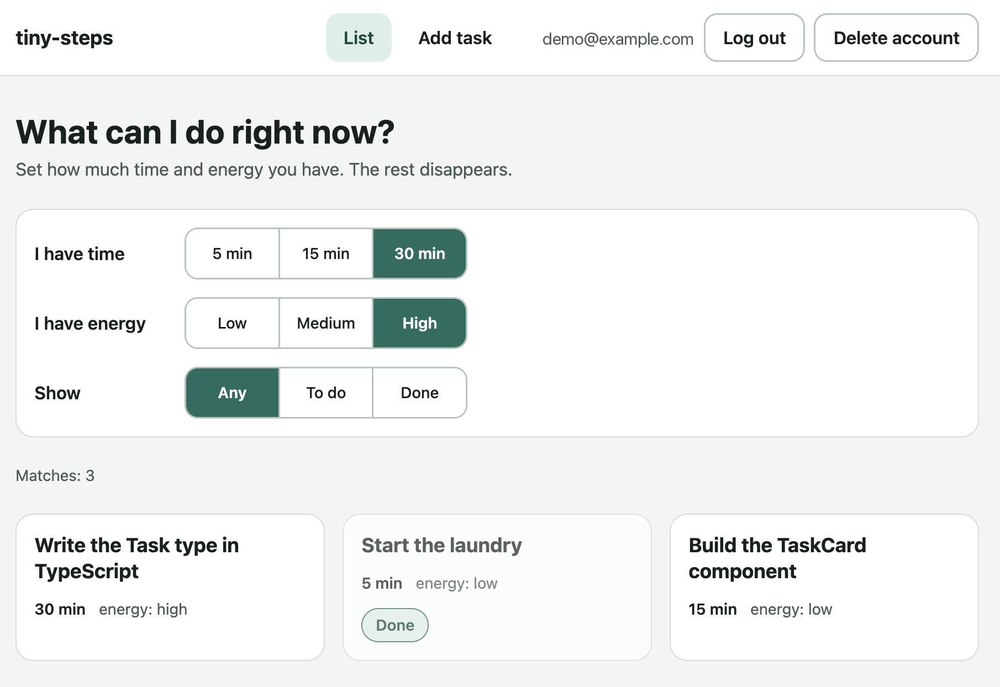

# tiny-steps

A task list filtered by how much time and energy you have right now. It shows only what fits.

[Live demo](https://tiny-steps-app.netlify.app)



## Features

- Sign up, log in and log out (Firebase Auth)
- Add tasks with estimated time and energy level
- Filter the list by available time, energy and status
- Mark tasks as done or not done
- Delete a task or your whole account (with password confirmation)
- Each user sees only their own tasks

## Tech stack

Vite, React, TypeScript, React Router, Firebase (Auth + Firestore), React Hook Form, Zod, CSS Modules, lucide-react, Vitest, Testing Library.

## Getting started

1. Install dependencies:

   ```bash
   npm install
   ```

2. Create a Firebase project with Auth (email and password) and Firestore enabled.
3. Copy `.env.example` to `.env` and fill in the values from your Firebase project settings.
4. In the Firebase console, open Firestore, then Rules, and paste the contents of `firestore.rules`. Without it, the database does not restrict access to each user's own tasks.
5. Start the dev server:

   ```bash
   npm run dev
   ```

## Scripts

- `npm run dev`: start the dev server
- `npm run build`: type-check and build for production
- `npm run preview`: preview the production build
- `npm run lint`: run ESLint
- `npm test`: run tests with Vitest

## Known limitations

These are deliberate choices to keep the project small.

- Deleting an account removes up to 500 tasks (the Firestore limit for one batch). An account with more tasks cannot be deleted.
- Tasks cannot be edited, only added, marked as done and deleted.
- The list loads once and does not update live. Other devices show changes after a reload.

## What I practiced

I built this project to refresh my React and TypeScript skills.

- Structuring a React and TypeScript app with routes, pages and small components.
- Keeping Firebase out of components by using services and custom hooks.
- Handling loading and error states, and avoiding race conditions in effects.
- Validating forms with React Hook Form and Zod.
- Protecting data with Firestore security rules, so each user reads only their own tasks.
- Building a mobile first layout with CSS Modules and shared design tokens.
- Writing tests with Vitest and Testing Library.
- Deploying to Netlify and testing the app on a real iPhone.
